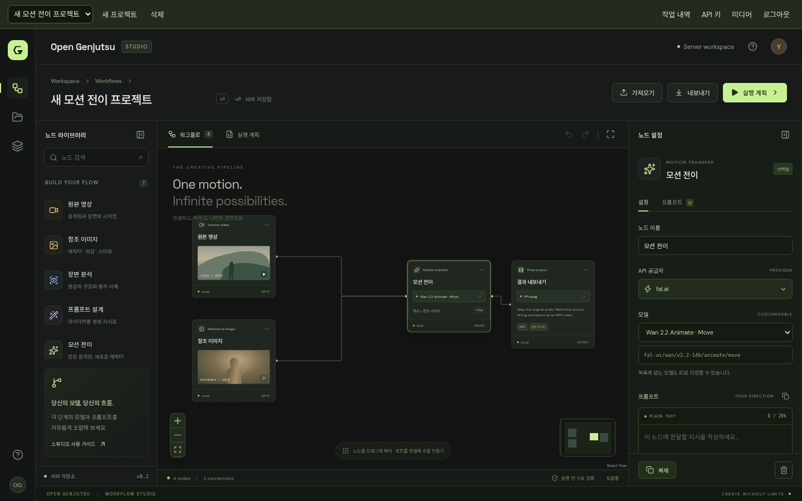
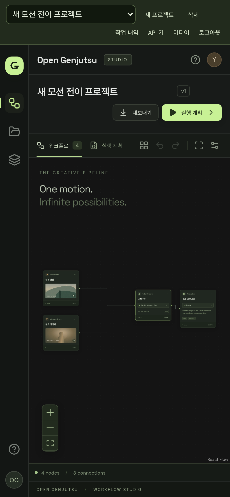

# 자체 호스팅 서비스 검증

검증일: 2026-10-08 (한국 시간). 대상은 Docker Compose로 실행한 Open Genjutsu 0.2.0이다. 실제 API, PostgreSQL, PostgreSQL에 이력을 저장하는 Temporal Server와 Worker를 구동했다. 유료 외부 요청은 제어 가능한 가짜 공급자를 사용했다.

## OpenRouter 단일 공급자 전환

2026-10-13. 생성 공급자를 OpenRouter로 통일하고 fal·Replicate·GPU Worker·Custom API 경로와 해당 검사(파일 업로드 포함)를 제거했다. 자동 검사는 백엔드 단위 49개, 실제 Temporal 통합 14개(로컬 2·OpenRouter 12), 프런트엔드 8개, 오프라인 편집기 브라우저 36개, 서비스 브라우저 16개로 구성된다. 당시 기본 모션 전이였던 Seedance 2.5로 원본 영상과 참조 이미지를 쓰는 생성은 실제로 실행하지 않았고 Higgsfield Genjutsu 대비 품질도 검증하지 않았다. 실제 OpenRouter 확인은 아래 2026-10-12 기록의 텍스트·이미지·이미지→영상(Grok) 연결까지다.

2026-10-13~14 실제 시험: Cloudflare quick tunnel로 로컬 스택에 임시 공개 HTTPS를 붙이고 같은 입력으로 모션 전이를 실행했다. 입력은 생성한 5초 854×480 영상(사실적인 젊은 남성이 팔을 들고 회전하고 손을 흔드는 춤)과 생성한 3D 여우 캐릭터 PNG(파란 후드티)이며, 프롬프트는 참조 캐릭터가 원본 영상의 동작을 따르도록 했다. OpenRouter는 서명 URL로 원본 영상과 참조 이미지를 정상으로 가져갔다(HTTP 200).

- Seedance 2.5: 두 번 접수 전에 거절됐다. 첫 번째는 원본 영상 화소 수 미달(848×480 < 407,696), 두 번째는 실제 인물로 보이는 영상 차단(`PrivacyInformation`, 사실적으로 생성한 인물 영상)이었다.
- MiniMax H3(`image_mode: reference`, 2K, 5초): 7분 36초 만에 성공했고 `usage.cost` $0.65가 청구됐다. 카탈로그의 `reference_images` $0.04는 청구되지 않았다. 결과는 2560×1440·5.2초이며 결과 내보내기가 원본 오디오를 붙였다. 프레임 비교에서 동작 순서와 타이밍(팔 들기 → 회전 → 허리에 손·손 흔들기), 여우의 얼굴·파란 후드티·흰 운동화·꼬리, 고정 카메라·배경이 유지됐다. 자세는 관절 단위로 일치하지 않았다(첫 자세의 팔이 머리 위가 아닌 어깨 높이, 회전 폭이 작음).
- FLUX.3 Video: 두 번 접수 전에 거절됐다. `image_mode: reference`는 이미지 참조 미지원, `first_frame`과 원본 영상 조합은 `frame_images`와 `input_references`를 한 요청에 쓸 수 없다는 사유였다. 원본 영상과 인물 이미지를 함께 받지 못해 모션 전이에 쓸 수 없다.

거절된 요청은 생성 요청 ID와 청구가 없었다. 입력 생성(이미지 $0.03·영상 $0.10)과 H3를 합한 시험 비용은 $0.78이다. Seedance 2.5 시험 뒤 단계 오류에 공급자 거절·실패 사유를 표시하도록 고쳤고, 같은 요청을 다시 보내 작업 내역에 실제 사유가 남는 것을 확인했다. FLUX.3 거절 사유도 같은 단계 오류로 확인했다. 이 결과로 모션 기본 모델을 MiniMax H3로 바꾸고(편집 기본은 Seedance 2.5 유지) 실행 전 확인이 초당 달러 SKU의 예상 비용을 계산하도록 했다. 변경 후 백엔드 단위 55개, 실제 Temporal 통합 15개(로컬 2·OpenRouter 13), 프런트엔드 8개, 오프라인 편집기 브라우저 36개, 서비스 브라우저 16개(다시 빌드한 Compose 스택)가 통과했다.

## 로컬 실제 API 연결 준비 검증

> 2026-10-13에 제거된 fal/Replicate 업로드 경로의 당시 기록이다. 현재 로컬에서 원본 영상을 쓰는 영상 생성에는 공개 HTTPS가 필요하다.

`feat/local-testing`에서는 무료 로컬 영상 템플릿과 fal/Replicate 파일 업로드 경로를 추가했다. 프런트엔드 7개, API·업로드 38개, 실제 Temporal 7개, 서비스 브라우저 16개를 실행해 총 68개가 통과했다. 아래 기존 검증에서 API 8개와 Temporal 2개가 늘었으며, 기존 오프라인·릴리스·Compose 재시작 검사는 이 변경에서 다시 실행하지 않았다.

업로드 검사는 공급자 공식 계약에 맞는 가짜 응답으로 파일 스트리밍·중복 제거·Replicate multipart 필드·키 전달 범위·사설 IP 차단·VACE URL 치환을 확인한다. 실제 Temporal에서는 업로드 성공 후 생성 제출 1회, 업로드 실패 시 제출 0회와 `FAILED` 종료를 확인했다. 서비스 브라우저는 무료 템플릿 선택부터 실제 MP4 업로드·저장·실행·오디오 포함 다운로드를 확인했다.

실제 공급자에 유료 요청을 보내지는 않았다. 사용자가 본인 PC에서 총 $10 이내로 업로드·생성·품질·청구액을 확인한다. 공개 도메인은 기본 `upload` 경로에 필요하지 않다.

## OpenRouter 전체 모델 연동 검증

검증일: 2026-10-12. OpenRouter 공개 카탈로그(659개, 영상 30·이미지 약 60)를 직접 조회하고, 실제 키로 소액 계약 시험을 수행했다. data URL 이미지·영상 분석, `/images` 생성과 data URL 참조, `/videos`의 텍스트·첫 프레임 data URL 생성, 인증이 필요한 결과 다운로드, 취소 API 부재(404), 지원 범위 밖 값의 무과금 400을 확인했다. 모델에 보내는 영상은 data URL을 거절하고 HTTPS만 허용했다.

자동 검사는 프런트엔드 8개, API·업로드·카탈로그 65개, 실제 Temporal 13개(OpenRouter 6개 추가), 오프라인 편집기 브라우저 36개, 서비스 브라우저 16개가 통과했다. Temporal 시험은 가짜 OpenRouter로 영상 POST 1회 보장(Worker 재시작·응답 유실 후 reconcile), 취소 시 원격 취소 미전송과 결과 내보내기 생략, 다른 호스트로 리다이렉트할 때 키 미전달, 결과 만료, 분석→이미지→영상→결과 내보내기 연결을 확인한다. 키 미전달 시험과 seed 제거 시험은 해당 코드를 되돌렸을 때 실패하는 것을 확인했다. 별도 적대적 리뷰에서 중복 과금·키 유출 경로는 발견되지 않았고, 지적된 이미지 단계 복구 오용·과금 후 저장 실패 시 파일 정리·data URL 크기 제한·고정 기본값 기준 검증·미지원 seed 전송을 수정했다.

로컬 Compose(`upload` 전달, HTTP)에서 실제 OpenRouter로 영상 전체 분석→참조 이미지 생성→1초 480p 영상 생성→FFmpeg 결과 내보내기를 실행해 원본 오디오가 포함된 MP4를 받았다. 단계별 실제 비용은 분석 $0.00002, 이미지 $0.03, 영상 $0.03이며 영상 예상 비용과 일치했다. 첫 시도는 분석 모델의 일시적 429로 재시도 없이 실패 처리됐다. 생성 품질 비교, HTTPS 환경에서 원본 영상을 쓰는 생성, 대량 요청은 검증하지 않았다.

## 기존 서비스 자동 검사 결과

| 검사 | 통과 | 범위 |
| --- | ---: | --- |
| 프런트엔드 단위 검사 | 7 | 프로젝트 직렬화, 연결과 실행 전 확인 |
| API·보안·모델 옵션 검사 | 30 | 로그인·CSRF·접근 제어, 키 암호화, 저장 충돌, 미디어·한도·중복 접수, 모델 옵션 범위·Kling 제출 payload, 관리자 운영 API |
| 실제 Temporal 통합 검사 | 5 | 로컬 영상 처리와 이력 replay, Worker 재시작, 생성 요청 응답 유실과 복구, 취소, FFmpeg 재시도 |
| Compose 재시작 검사 | 1 | 실제 PostgreSQL에 대기 작업 저장, API·Worker 재시작 후 실행과 결과 유지 |
| 오프라인 편집기 브라우저 회귀 | 36 | 데스크톱·모바일 편집, 저장·가져오기·내보내기, 모달·키보드·접근성 |
| 서비스 브라우저 검사 | 16 | 로그인·저장·모델 옵션, 키 관리, 업로드·실행·다운로드, 관리자 운영 현황, 로그아웃·삭제 |
| 릴리스·배포 계약 검사 | 19 | 버전·이미지·롤백·백업 계약, reviewer 없는 게시 차단과 main 정책, Tunnel Compose 선택 |
| **합계** | **114** | 서로 다른 테스트 실행의 합계 |

TypeScript 빌드, Python Ruff 검사, Compose 구성 검사와 Docker 이미지 빌드도 통과했다. 실제 서비스 DB에 Alembic migration 0001~0003을 적용했다. TestClient 의존성의 deprecation 경고는 남아 있다.

브라우저 검사는 Playwright와 시스템 Chromium으로 수행했다. 서비스 화면은 1440×900 데스크톱과 Pixel 7 크기의 모바일 에뮬레이션에서 검증했다. 편집기와 API 키 대화상자의 검사 대상 상태에서 axe WCAG A/AA 위반은 없었다. 이는 전체 서비스의 접근성 인증을 의미하지 않는다.

## 장애와 실제 결과 확인

- 같은 실행 요청 키를 다시 제출하면 같은 작업을 반환한다.
- Worker를 중지한 상태에서 접수한 작업이 API 재시작 후에도 남고, Worker를 시작하면 완료된다.
- 외부 제출 응답을 잃으면 자동 재제출하지 않는다. `NEEDS_REVIEW`로 보관한 뒤 검증된 생성 요청 ID로 복구해도 공급자 POST 횟수는 1회다.
- 공급자 취소 요청 후 최종 상태를 기다리며, 결과가 확정되기 전 성공으로 표시하지 않는다.
- 안전한 로컬 FFmpeg 처리는 일시 실패 후 재시도된다. 유료 제출에는 같은 재시도 정책을 적용하지 않는다.
- 실제 MP4를 업로드해 Temporal과 FFmpeg로 처리하고, 원본 오디오가 포함된 MP4를 다운로드했다. 서비스 재시작 후에도 다운로드할 수 있었다.

## 백업과 운영

`scripts/backup.sh`를 실제 실행해 활성·확인 대기 작업 검사, 쓰기 프로세스 중지, 애플리케이션·Temporal DB dump, 미디어와 환경 설정의 묶음 보관, 서비스 재시작을 확인했다. 백업에는 비밀 키가 있으므로 저장소에 포함하지 않는다.

`restore_drill.py`로 같은 호스트의 새 격리 프로젝트·빈 볼륨에 전체 묶음을 복원했다. 미디어 22개의 크기·SHA256, 저장 키 10개의 복호화, 작업 11개, 완료 Temporal 이력 1개의 replay를 검증했다. 복원 후 새 로컬 작업 1개를 실행해 결과 다운로드와 오디오를 확인했으며 복원~검증은 약 40초였다. 이 시간은 작은 테스트 백업의 수치이며 별도 물리 호스트의 운영 RTO가 아니다. 원래 서비스와 볼륨을 변경하지 않고 격리 프로젝트만 제거했다. 복호화한 키는 테스트용 키이며 실제 유료 키가 아니다.

`service_probe.py`로 사용자 3명·각 2개 작업을 동시 실행했다. 6개 모두 완료, 같은 접수 키 6번 재요청은 같은 작업, 결과물 6개 모두 영상·오디오 유지였다. 계정별 두 작업 묶음의 P95는 약 3.2초이며 대규모 처리량 벤치마크가 아니다. 유료 호출은 0회다.

## 확인하지 않은 범위

OpenRouter 공개 모델 목록과 영상 모델 능력, 임시 quick tunnel의 공개 HTTPS로 생성한 입력 1건의 MiniMax H3 모션 전이 성공을 확인했다. 실제 촬영한 인물 영상의 모션 전이, Higgsfield Genjutsu 대비 품질, 시험하지 않은 모델(Seedance 2.0·2.0 Fast 포함)과 그 밖의 실제 유료 생성 품질·과금, 도메인을 연결한 Tunnel 접속, 별도 호스트 복원, 대규모 부하와 다중 호스트 HA는 아직 검증하지 않았다. Cloudflare Compose는 구성 검사를 통과했고 이미지 digest를 고정했으나 실제 Tunnel 토큰·도메인이 없어 접속 성공으로 기록하지 않는다. 실제 모델 평가의 승인 비용은 총 $10이며 2026-10-13~14 시험에 $0.78을 사용했다. 모바일은 Chromium 에뮬레이션으로 실제 iOS Safari·Firefox 검사는 포함하지 않는다.

기존 서비스 PR #2와 릴리스 체계 PR #1은 CI 통과 후 main에 병합했다. GitHub release Environment와 main 보호 변경은 현재 연결 권한에서 403으로 차단됐고 운영자 설정이 필요하다. 릴리스 워크플로는 reviewer·main 정책을 확인할 수 없으면 게시를 중단한다. 실제 태그·RC·Release·외부 배포는 아직 생성하지 않았다.

자세한 배포·복구 절차는 [운영 가이드](operations.ko.md), 지원하는 모델 옵션은 [공급자 계약](provider-contract.ko.md)을 따른다.

## 화면 기록

